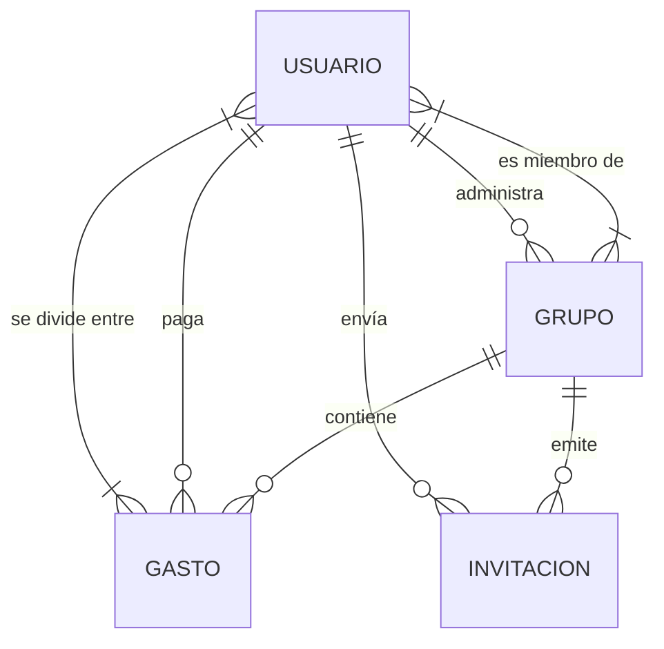

# Splitio

Aplicación web para registrar y saldar gastos compartidos entre grupos de
personas: quién pagó qué, cómo se reparte y quién le debe a quién.

Calcula los balances de cada integrante y reduce las deudas al mínimo número de
transferencias posibles, para que en vez de seis pagos cruzados el grupo cierre
con dos.

---

## Contenido

- [Características](#características)
- [Stack](#stack)
- [Estructura](#estructura)
- [Requisitos](#requisitos)
- [Puesta en marcha](#puesta-en-marcha)
- [Variables de entorno](#variables-de-entorno)
- [Scripts](#scripts)
- [API](#api)
- [Modelo de datos](#modelo-de-datos)
- [Rutas del frontend](#rutas-del-frontend)
- [Deploy (Render + Neon)](#deploy-render--neon)
- [Licencia](#licencia)

---

## Características

**Grupos**
- Creación de grupos con nombre, descripción y emoji identificatorio.
- Hasta 10 integrantes por grupo (incluido el creador).
- El creador es el administrador y es quien puede generar o revocar códigos de invitación.
- Solo el administrador puede quitar a otros integrantes; el administrador no puede salir del grupo y nadie puede salir con saldo pendiente.
- Apodo, alias de pago y CBU configurables **por grupo**, además de los globales del perfil.

**Invitaciones**
- Invitación personal por email, de un solo uso.
- Código compartible reusable, sin vencimiento y revocable por el administrador.
- Los invitados que todavía no tienen cuenta quedan registrados como pendientes y se activan al completar el registro.

**Gastos**
- Alta de gastos con descripción, monto, categoría, fecha y pagador.
- Reparto entre los integrantes que se elijan, no necesariamente todo el grupo.
- Eliminación de gastos por quien los pagó o por el administrador del grupo.
- Registro de saldos de deuda (`settlements`) para marcar pagos ya realizados, por el deudor, el acreedor
  o el administrador del grupo, sin superar la deuda pendiente.

**Balances**
- Balance neto por integrante: cuánto puso de más o de menos.
- Cálculo de deudas minimizadas mediante emparejamiento de acreedores y deudores.
- Resumen del grupo descargable en PDF o enviado por email.

**Cuentas**
- Registro y login con JWT (access token de 15 min + refresh token de 7 días).
- Recupero de contraseña por email, con token hasheado y expiración.
- Avatar subible, alias de pago y CBU en el perfil.
- Preferencias de notificación por email (invitaciones y resúmenes).
- Tema claro/oscuro persistido.

---

## Stack

| | |
|---|---|
| **Frontend** | React 19, Vite 8, Tailwind CSS 4, Zustand 5, React Router 7, ApexCharts, Sonner |
| **Backend** | Node.js, Express 5, Knex 3 (query builder), PostgreSQL, JWT, bcrypt |
| **Servicios** | Resend (emails), PDFKit (resúmenes en PDF), Multer (subida de avatares) |
| **Docs** | OpenAPI 3.0 + Swagger UI |

---

## Estructura

```
split_expenses/
├── backend/
│   ├── migrations/       # Migraciones Knex (001 a 014)
│   ├── seeds/            # Datos de ejemplo
│   ├── src/
│   │   ├── config/       # Instancia de Knex
│   │   ├── controllers/  # Lógica de cada recurso
│   │   ├── docs/         # Spec OpenAPI
│   │   ├── middleware/   # Auth JWT, subida de avatares, manejo de errores
│   │   ├── routes/       # auth, users, groups, expenses, invitations
│   │   ├── services/     # Email (Resend) y generación de PDF
│   │   ├── utils/        # Autorización, invitaciones, helpers
│   │   ├── validators/   # Reglas de express-validator
│   │   └── index.js      # Entrypoint
│   └── knexfile.js
├── frontend/
│   └── src/
│       ├── api/          # Cliente fetch con refresh automático de token
│       ├── components/
│       ├── pages/
│       ├── router/
│       ├── stores/       # Estado global con Zustand
│       └── utils/        # Formato de moneda y fechas, agrupaciones, helpers
├── shared/               # Código compartido por frontend y backend
│   └── balances.mjs      # Cálculo de balances y deudas (fuente única)
└── render.yaml           # Blueprint de Render (deploy)
```

Arquitectura del backend en capas: `routes → validators → controllers → knex`.

`shared/balances.mjs` es la **única** implementación del cálculo de balances: la importan las
vistas de React (alias `@shared`) y el backend (`buildGroupSummaryData`, que alimenta
`GET /groups/:id/balances` y el resumen en PDF). Trabaja en centavos enteros, así que la UI, la
API y el PDF muestran siempre los mismos números.

---

## Requisitos

- **Node.js 22.12+** (Vite 8 y el `require()` de ESM de `shared/balances.mjs` lo necesitan;
  20.19+ también funciona, pero `engines` declara 22.12+)
- **PostgreSQL 13+**
- Una cuenta de [Resend](https://resend.com) si querés que se envíen los emails
  (opcional: sin la API key la app funciona igual y omite el envío).

---

## Puesta en marcha

### 1. Clonar e instalar

```bash
git clone <url-del-repo>
cd split_expenses

cd backend && npm install
cd ../frontend && npm install
```

### 2. Crear la base de datos

```bash
createdb split_expenses
```

### 3. Configurar el backend

```bash
cd backend
cp .env.example .env
```

Editá `.env` con tus credenciales de PostgreSQL y, como mínimo, completá
`JWT_SECRET` y `JWT_REFRESH_SECRET` (vienen vacíos y la app no arranca bien sin
ellos). Podés generarlos con:

```bash
node -e "console.log(require('crypto').randomBytes(32).toString('hex'))"
```

Ver la [tabla completa de variables](#variables-de-entorno) para el detalle de
cada una.

### 4. Migrar la base

```bash
cd backend
npm run migrate       # crea el esquema
npm run seed          # opcional: datos de ejemplo
```

### 5. Levantar ambos servidores

En dos terminales:

```bash
cd backend && npm run dev     # API en http://localhost:3001
```

```bash
cd frontend && npm run dev    # App en http://localhost:5173
```

El dev server de Vite proxea `/api` al backend, así que no hace falta
configurar nada más para desarrollo local.

---

## Variables de entorno

Las del backend se leen en `backend/.env`. El frontend tiene una sola, `VITE_API_URL`
(ver `frontend/.env.example`): vacía en desarrollo, y en producción el origen del
backend (ej. `https://splitio-api.onrender.com`). Se embebe al buildear.

| Variable | Requerida | Default | Descripción |
|---|---|---|---|
| `JWT_SECRET` | **sí** | — | Firma de los access tokens (15 min) |
| `JWT_REFRESH_SECRET` | **sí** | — | Firma de los refresh tokens (7 días) |
| `DB_HOST` | sí | `localhost` | |
| `DB_PORT` | sí | `5432` | |
| `DB_NAME` | sí | `split_expenses` | |
| `DB_USER` | sí | `postgres` | |
| `DB_PASSWORD` | sí | `postgres` | |
| `DATABASE_URL` | solo producción | — | String de conexión completo; tiene prioridad sobre las `DB_*` cuando `NODE_ENV=production` |
| `NODE_ENV` | no | `development` | Selecciona la configuración de `knexfile.js` |
| `PORT` | no | `3001` | Puerto del backend |
| `CORS_ORIGIN` | no | `FRONTEND_URL`, o `http://localhost:5173` | Origen(es) permitido(s) por CORS, separados por coma |
| `TRUST_PROXY` | no | `1` | Saltos de proxy confiables para leer la IP real (rate limit). `0` ignora `X-Forwarded-For` |
| `FRONTEND_URL` | no | `http://localhost:5173` | Base de los enlaces que se envían por email |
| `RESEND_API_KEY` | no | — | Sin ella, los envíos se omiten con un warning en consola y el resto de la app funciona |
| `EMAIL_FROM` | no | `Splitio <onboarding@resend.dev>` | Remitente de los emails |

`backend/.env.example` incluye todas estas variables, comentadas y con los
valores de desarrollo por defecto ya cargados.

---

## Scripts

### Backend (`cd backend`)

| Comando | Descripción |
|---|---|
| `npm run dev` | Servidor con recarga automática (nodemon) |
| `npm start` | Servidor en modo producción |
| `npm run migrate` | Aplica las migraciones pendientes |
| `npm run migrate:rollback` | Revierte el último lote de migraciones |
| `npm run seed` | Carga los datos de ejemplo |

### Frontend (`cd frontend`)

| Comando | Descripción |
|---|---|
| `npm run dev` | Dev server de Vite en el puerto 5173 |
| `npm run build` | Build de producción a `dist/` |
| `npm run preview` | Sirve el build de producción |
| `npm run lint` | ESLint |

---

## API

Base: `/api`. Todos los endpoints requieren el header
`Authorization: Bearer <access_token>` salvo los marcados como públicos.

Con el backend levantado, la documentación interactiva queda en
**http://localhost:3001/api/docs** y el spec crudo en `/api/docs.json`.
`GET /api/health` (público) responde `{ "status": "ok" }` si el servidor y la base
están accesibles.

### Autenticación — `/api/auth` (público, límite de 10 req / 15 min)

| Método | Ruta | Descripción |
|---|---|---|
| `POST` | `/register` | Crear cuenta |
| `POST` | `/login` | Iniciar sesión |
| `POST` | `/refresh` | Renovar el access token |
| `POST` | `/forgot-password` | Solicitar el email de recupero |
| `POST` | `/reset-password` | Definir la nueva contraseña con el token |

### Usuarios — `/api/users`

| Método | Ruta | Descripción |
|---|---|---|
| `GET` | `/` | Usuarios con los que compartís algún grupo |
| `GET` | `/me` | Perfil propio |
| `PUT` | `/me` | Actualizar el perfil propio |
| `POST` | `/me/avatar` | Subir avatar (se guarda en la base, tabla `user_avatars`) |
| `DELETE` | `/me/avatar` | Eliminar avatar |
| `GET` | `/:id/avatar` | Imagen del avatar (**público**, lo pide un ``) |
| `GET` | `/:id` | Ver un usuario |
| `PUT` | `/:id` | Actualizar un usuario |

### Grupos — `/api/groups`

| Método | Ruta | Descripción |
|---|---|---|
| `GET` `POST` | `/` | Listar y crear grupos |
| `GET` `PUT` `DELETE` | `/:id` | Ver, editar y eliminar un grupo |
| `GET` `POST` | `/:id/members` | Listar y agregar integrantes |
| `PUT` `DELETE` | `/:id/members/:userId` | Editar overrides y quitar a un integrante |
| `GET` | `/:id/balances` | Balances y deudas minimizadas |
| `POST` | `/:id/summary` | Enviar el resumen por email |
| `GET` | `/:id/summary/pdf` | Descargar el resumen en PDF |
| `GET` `POST` | `/:id/invitations` | Listar invitaciones e invitar por email |
| `DELETE` | `/:id/invitations/:invitationId` | Revocar una invitación |
| `GET` | `/:id/invite-code` | Ver el código compartible |
| `POST` `DELETE` | `/:id/invite-code` | Generar y revocar el código (solo admin) |

### Gastos — `/api/expenses`

| Método | Ruta | Descripción |
|---|---|---|
| `GET` `POST` | `/` | Listar y crear gastos |
| `POST` | `/settle` | Registrar un saldo de deuda |
| `GET` `DELETE` | `/:id` | Ver y eliminar un gasto |

### Invitaciones — `/api/invitations`

| Método | Ruta | Descripción |
|---|---|---|
| `GET` | `/:token` | Vista previa de la invitación (**público**) |
| `POST` | `/:token/accept` | Aceptar la invitación y unirse al grupo |

---

## Modelo de datos

Siete tablas en PostgreSQL con claves primarias UUID (la séptima, `user_avatars`, guarda
la imagen de perfil de cada usuario y no figura en el diagrama).



Tres detalles de implementación que conviene saber al leer el código:

- Los saldos de deuda se guardan como gastos con `category = 'settlement'`; la
  mayoría de las agregaciones los filtran.
- El límite de 10 integrantes por grupo vive en `MAX_GROUP_MEMBERS`
  (`backend/src/utils/invitations.js`) y se valida en el backend, no solo en la UI.
- Cuando un gasto no se divide exacto, los centavos sobrantes van a los primeros participantes
  en el orden en que la base devuelve `expense_splits` (no hay columna de orden). En la práctica
  es el orden de inserción; cambiar esa regla alteraría balances de gastos ya cargados.

---

## Rutas del frontend

| Ruta | Acceso | Página |
|---|---|---|
| `/login` | público | Iniciar sesión |
| `/register` | público | Crear cuenta |
| `/forgot-password` | público | Solicitar recupero de contraseña |
| `/reset-password` | público | Definir nueva contraseña |
| `/invitacion/:token` | público | Aceptar una invitación |
| `/` | privado | Dashboard |
| `/grupos` | privado | Listado de grupos |
| `/grupos/:id` | privado | Detalle del grupo |
| `/gastos` | privado | Listado de gastos |
| `/balances` | privado | Balances y deudas |
| `/perfil` | privado | Perfil y preferencias |

---

## Deploy (Render + Neon)

Entorno de testing con planes gratuitos: **Render** para el frontend (Static Site) y el
backend (Web Service free), **Neon** para PostgreSQL y **Resend** para los emails. Todo
está descripto en `render.yaml` (Blueprint).

| Servicio | Plan free | Lo que implica |
|---|---|---|
| Render Web Service (API) | 512 MB, 0.1 CPU, 750 h/mes | Se duerme tras 15 min sin tráfico; el primer request tarda ~1 min. Disco efímero (por eso los avatares van a la base). |
| Render Static Site (front) | CDN, no se duerme | 5 GB/mes de transferencia en el plan Hobby. |
| Neon | 1 GB, 100 CU-h/mes | Se suspende tras 5 min sin uso y despierta en el siguiente query. |
| Resend | 100 mails/día, 3000/mes | Con `onboarding@resend.dev` solo llegan a tu propia dirección: hace falta un dominio verificado. |

### 1. Base de datos en Neon

1. Crear un proyecto en [neon.com](https://neon.com), región **AWS US East (N. Virginia)**
   (la misma zona que el backend en Render).
2. En *Connect*, copiar la connection string **directa** (desactivar *Connection pooling*,
   el host no debe tener `-pooler`). Termina en `?sslmode=require`; si incluye
   `&channel_binding=require` se puede dejar.

### 2. Dominio para los emails (Resend)

1. Comprar un dominio (ej. `.com.ar` en NIC Argentina, o `.com` en Cloudflare Registrar /
   Porkbun) y gestionar su DNS en Cloudflare (gratis).
2. En Resend → *Domains* → *Add domain*: usar un subdominio, ej. `mail.tudominio.com`.
3. Cargar en Cloudflare los registros que muestra Resend (MX y TXT de SPF, TXT de DKIM;
   DMARC opcional) con el proxy de Cloudflare **apagado** (nube gris) → *Verify*.
4. Crear una API key en Resend (*Sending access*).
5. `EMAIL_FROM` pasa a ser `Splitio <no-reply@mail.tudominio.com>`.

### 3. Servicios en Render

1. Render → *New* → *Blueprint* → elegir este repositorio. Detecta `render.yaml` y crea
   `splitio-api` y `splitio-web`. `JWT_SECRET` y `JWT_REFRESH_SECRET` se generan solos.
2. Completar las variables que pide:
   - `DATABASE_URL`: la de Neon.
   - `RESEND_API_KEY` y `EMAIL_FROM`.
   - `CORS_ORIGIN`, `FRONTEND_URL` y `VITE_API_URL`: si todavía no conocés las URLs, poné
     `https://splitio-web.onrender.com` y `https://splitio-api.onrender.com` (Render usa el
     nombre del servicio, con un sufijo si ya está tomado) y corregilas después.
3. El build del backend corre `npm run migrate` contra Neon (el plan free no tiene
   pre-deploy command). **No** corras `npm run seed` en producción: son datos de ejemplo.
4. Cuando ambos estén *Live*, verificar las URLs reales. Si alguna cambió, actualizar
   `VITE_API_URL` en `splitio-web` (requiere un nuevo deploy: se embebe en el build) y
   `CORS_ORIGIN`/`FRONTEND_URL` en `splitio-api`.
5. Opcional: dominios propios en Render (*Settings → Custom Domains*), ej. `app.` para el
   front y `api.` para la API, con CNAME en Cloudflare. Después actualizar las tres
   variables anteriores. `CORS_ORIGIN` acepta varios orígenes separados por coma.

### 4. Verificar

- `https://<api>/api/health` → `{ "status": "ok" }` y `https://<api>/api/docs` carga.
- En el front: registro, login, recargar la página en `/grupos/:id` (rewrite de la SPA),
  crear grupo y gasto, saldar una deuda, subir un avatar, invitación por email y por
  código, recupero de contraseña y resumen en PDF.

Para evitar el cold start se puede programar un ping a `/api/health` cada 14 min
(ej. [cron-job.org](https://cron-job.org)): un servicio despierto 24/7 usa ~720 h, dentro
de las 750 h gratis, pero mantiene la base de Neon activa y consume sus CU-h.

---

## Licencia

ISC, según lo declarado en `backend/package.json`. El repositorio todavía no
incluye un archivo `LICENSE`.
